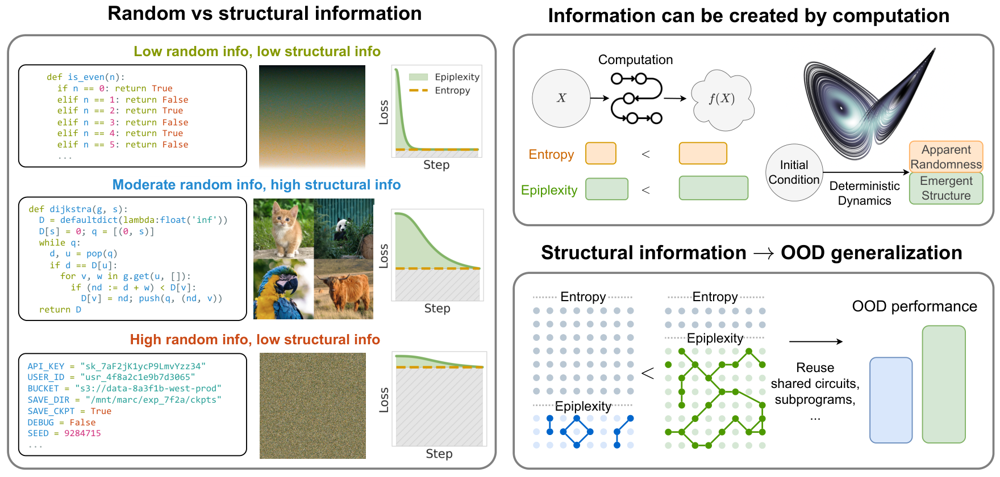
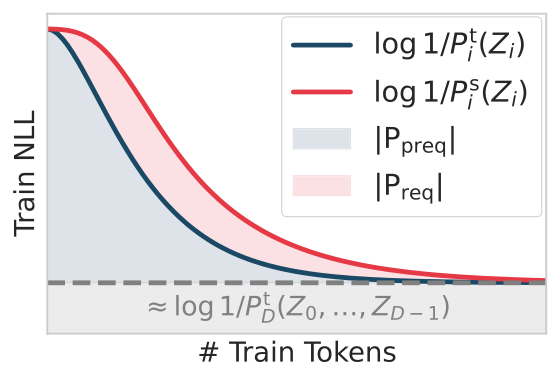
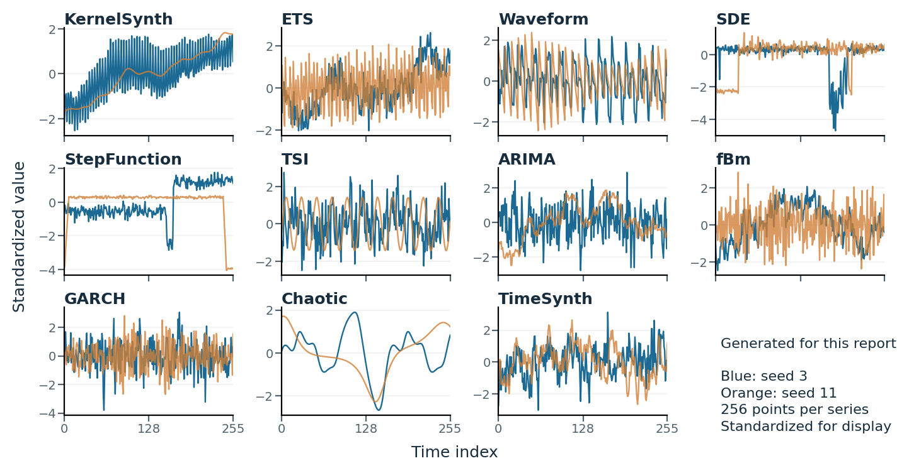
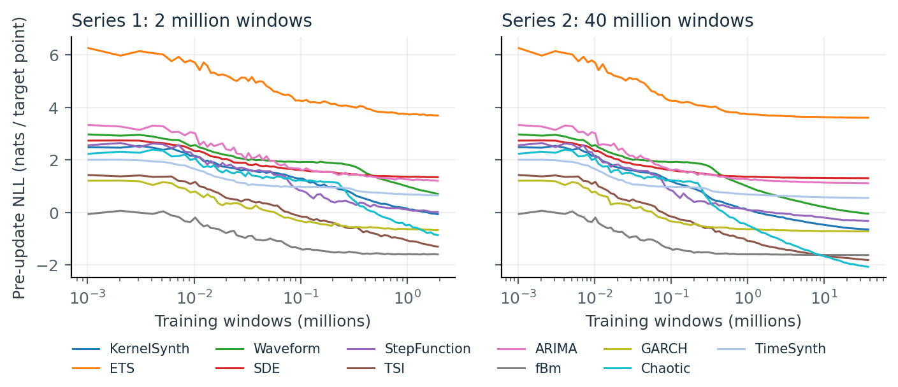
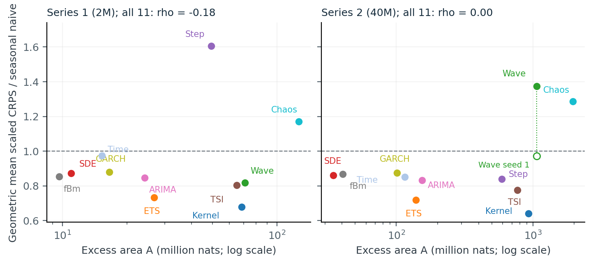
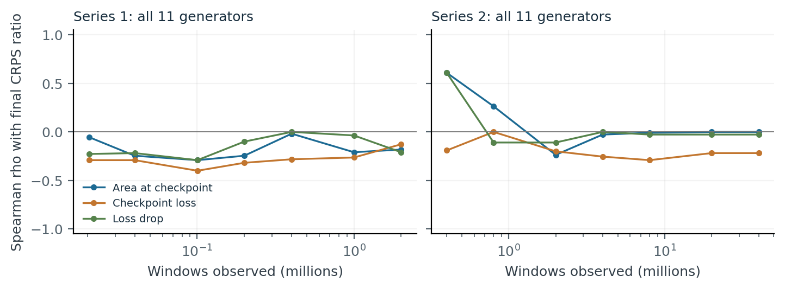

## Choosing data before knowing what will transfer

Suppose you can generate unlimited training data for a forecasting model. You can give it periodic signals, noisy trends, volatility clusters, chaotic trajectories, or samples from Gaussian processes. Every source is cheap to describe. Some are easy to predict; others keep a transformer busy for millions of examples. Which source should you choose if the eventual task is forecasting real time series?

The difficulty is deciding what makes synthetic experience useful. Low training loss may mean that a task is trivial. High loss may mean that its uncertainty is irreducible. A long learning process may build reusable representations, or teach details with little relevance to the deployment distribution. Dataset size and final predictive loss do not distinguish all these cases.

**Our question is whether the amount of structure learned during synthetic pretraining helps predict transfer.** Epiplexity provides the theoretical motivation; excess prequential loss provides a statistic we can compute from training logs. Using our `episynth` pipeline, we trained a probabilistic Moirai-based transformer from scratch on eleven synthetic priors, at approximately 2 million and 40 million windows per prior, and evaluated transfer on 55 short-term GIFT-Eval configurations.

The answer has two parts. KernelSynth and ETS gave the strongest aggregate transfer at both budgets. But across all eleven priors, the Spearman correlation between excess area and downstream CRPS error was **−0.18 at 2M and 0.00 at 40M**. The hoped-for relationship would be negative: more learned structure, lower forecasting error. Our measurements do not establish that ranking rule.

Understanding this result requires separating three things: a formal measure of accessible structure, an algorithm-dependent proxy for that measure, and usefulness for a particular downstream distribution. We develop that distinction first, then follow it through the experiment. Our original results and numerical claims come from [*Epiplexity and Transfer in Synthetic Time-Series Pretraining*](https://github.com/intsystems/Epiplexity/blob/main/publications/technical_report/main.tex), with its [compiled report](https://github.com/intsystems/Epiplexity/blob/main/publications/technical_report/main.pdf) and [supporting analysis](https://github.com/intsystems/Epiplexity/tree/main/publications/technical_report/data).

## From uncertainty to accessible structure

### What entropy and program length leave out

For a discrete random variable $X$ with distribution $p$, Shannon entropy is

$$
H(X)=\mathbb E[-\log_2 p(X)].
$$

It measures uncertainty before observing a draw and bounds its expected lossless code length. Kolmogorov complexity $K(x)$ instead measures the length of the shortest program that outputs one realized string $x$ on a fixed universal machine ([Li and Vitányi, 2008](#ref-livitanyi2008)). Neither quantity specifies how much computation a learner has available to discover or use a pattern.

A uniform random string has high entropy and typically a long shortest description. An alternating string has a short description once its length is known. A pseudorandom sequence is the revealing intermediate case: a short seed and program reproduce it, yet an efficient observer may be unable to distinguish it from random data. Short description and accessible regularity are different properties.

Final predictive loss adds another perspective, but combines several effects. In the discrete case, predicting a true distribution $p$ with a model $q$ gives expected log-loss

$$
\mathbb E_p[-\log_2 q(X)]=H(p)+\mathrm{KL}(p\Vert q).
$$

The first term is uncertainty in the data; the second is predictive mismatch. A single endpoint does not describe how much the model learned on its way there. Nor does it say whether what it learned will help on another distribution.

### A two-part code with a time bound

[Finzi et al. (2026), version 2](https://arxiv.org/html/2601.03220v2#S3) define epiplexity using probabilistic programs that can both evaluate probabilities and sample within a time bound $T$. Let $\mathcal P_T$ be that class. For a random finite bit string $X$, select

$$
\mathrm P^\star\in\arg\min_{\mathrm P\in\mathcal P_T}
\left\{|\mathrm P|+\mathbb E[-\log_2 P(X)]\right\},
$$

breaking ties in favor of the shortest program. Here $|\mathrm P|$ is the program length in bits, and $P$ is its probability distribution. The formal definition fixes a prefix-free universal machine and requires normalized, finite-binary probabilities, with evaluation and sampling each satisfying the runtime bound.

The optimal description has two parts:

$$
S_T(X)=|\mathrm P^\star|,\qquad
H_T(X)=\mathbb E[-\log_2 P^\star(X)],\qquad
\mathrm{MDL}_T(X)=S_T(X)+H_T(X).
$$

**Epiplexity $S_T$ is the model part; time-bounded entropy $H_T$ is the residual data part.** The optimization chooses the shortest total description available to the observer, rather than maximizing model size. A useful model costs bits to describe but saves bits when encoding data. What remains unexplained is paid for in the residual code.

*Figure 1. The motivation for separating model structure from residual uncertainty. In the learning-curve illustration, cumulative loss above a final-loss baseline serves as a model-part proxy. The transfer diagram expresses a motivation for data selection, not a guarantee for a particular downstream task. Source: Finzi et al., Fig. 1.*

The observer matters. A larger budget can make a previously inaccessible regularity usable, or allow a simpler program to replace an elaborate approximation. The optimal total code cannot increase when the admissible program class expands; its model part need not move monotonically. Epiplexity is therefore not an intrinsic dataset score independent of computational resources.

For forecasting, the relevant extension is conditional: the context $C$ is already available, and the model describes a distribution of future values $Y$ given $C$. The model part is then $S_T(Y\mid C)$. Our continuous-valued experiment uses conditional densities and a fixed dequantization protocol, which introduces additional conventions beyond the finite-string definition.

### Three consequences for synthetic data

The time bound changes how three familiar information-theoretic arguments apply to synthetic data.

First, **computation can change what information is accessible**. Deterministic maps cannot increase Shannon entropy, and applying a short program cannot greatly increase unbounded Kolmogorov complexity. Those statements do not bound runtime. Under suitable cryptographic assumptions, Finzi et al. show that pseudorandom expansion can increase time-bounded entropy while leaving little accessible structure. Their cellular-automaton experiments separately illustrate computation producing structure detectable by neural observers. These are distinct theoretical and empirical claims.

Second, **prediction order can matter to a bounded observer**. Shannon's chain rule equates the joint entropy in either order. For a one-way permutation, predicting its output from its input can be efficient while recovering the input from the output is hard. Finzi et al.'s formal asymmetry concerns time-bounded quantities under a one-way-permutation assumption; their automaton and chess experiments examine order effects empirically.

Third, **generation and prediction can require different computations**. A generator can choose a hidden state and produce observations from it. A predictor seeing only the observations may need to infer that state, or average over possible states. Matching the observable distribution can therefore require an inference procedure absent from the sampler. This motivates synthetic tasks with latent mechanisms, but does not prove that every predictor is more complex than its generator.

Together, these ideas make synthetic-data selection a question about the observer and its task. They do not yet tell us which learned mechanisms will transfer to real forecasting problems.

## Measuring structure through a training trajectory

### Prequential coding: predict, transmit, then update

Prequential coding turns learning into a sequential description of data ([Dawid, 1984](#ref-dawid1984); [Blier and Ollivier, 2018](#ref-blier2018)). Sender and receiver share an initialization, deterministic update procedure, schedule, and random seed. Before update $i$, both have model $P_i$. The sender codes the next batch $Z_i$ using $P_i$; the receiver decodes it. Only then do both update to $P_{i+1}$.

The ideal data-code length is

$$
L_{\rm preq}=\sum_{i=0}^{M-1}-\log_2 P_i(Z_i).
$$

Replaying the decoded data reconstructs the final model as well. This is a code for the data and the training outcome, including unpredictable data bits. It is not a separate model code.

To isolate a model-part proxy, subtract the length of describing those data with the final model:

$$
\widehat K_{\rm preq}
=L_{\rm preq}-L_{\rm final},\qquad
L_{\rm final}=\sum_{i=0}^{M-1}-\log_2 P_M(Z_i).
$$

Geometrically, this is the area between the online loss curve and a horizontal final-model baseline, weighted by the number of observations. A sustained loss reduction produces a larger area. A high but flat curve contributes little excess: unpredictable data can be expensive to encode without teaching much structure.

The interpretation follows the idea of separating a model description from a conditional data description ([Zhang et al., 2020](#ref-zhang2020)). It remains a heuristic. Subtracting two computable code lengths does not establish the difference between the corresponding shortest programs, and the argument does not supply a model-only decoder meeting the formal time bound. Replacing final loss on the training sequence with held-out loss makes the generalization gap another part of the measurement protocol.

### Requential coding: describe what changes the student

Requential coding takes a more direct route to describing a model. A teacher supplies a target distribution; sender and receiver share a student and indexed random proposals from that student. Relative entropy coding lets the sender communicate an index selecting a teacher-distributed example from those proposals. The receiver regenerates it and applies the same student update. The messages reconstruct the student without transmitting the teacher or the original dataset ([Theis and Ahmed, 2022](#ref-theis2022); [Qiu et al., 2026](https://arxiv.org/html/2607.11883v1#S3)).

Its leading coding cost is cumulative teacher–student KL divergence on teacher-distributed samples. Universal index coding adds overhead, so the KL sum alone is not the complete expected message length. Unlike prequential coding, the protocol selects examples rather than losslessly transmitting a pre-existing sequence. The plotted teacher–student loss gap on real data is an empirical approximation, not generally that KL divergence. Our forecasting runs use the prequential proxy; they do not implement this requential protocol.

*Figure 2. Blue: a prequential model-part proxy above a final-loss baseline. Red: the teacher–student gap used to illustrate requential estimation. This is a schematic from Finzi et al., Fig. 2a, not a measurement from our forecasting runs; exact requential cost involves KL on teacher samples and coding overhead.*

The full empirical procedure in Finzi et al. also searches over model sizes and training lengths, selecting the shortest total two-part code under a compute bound. Our study holds one architecture fixed and compares data budgets. An excess area from one run is not the result of that optimization.

### The signed area we actually measure

Let $g$ be a synthetic distribution over context–target pairs. In optimizer step $k$, let $u_k$ be the mean negative log density **per target point**, evaluated before updating the model. Our batch size is $B=1024$ and horizon is $h=64$. After $K$ steps, $N=BK$ windows have been observed. Let $\widehat\ell_N^{\rm EMA}$ be the final held-out loss in **nats per window**, using an exponential moving average (EMA) of the weights. We compute

$$
A_N=Bh\sum_{k=1}^{K}u_k-N\widehat\ell_N^{\rm EMA},
\qquad \widehat S_N=\frac{A_N}{\ln 2}.
$$

The factor $Bh$ converts each step's mean loss into a sum over its target points. We report $A_N$ in million nats, matching the technical report; division by $\ln 2$ converts nats to bits. **We retain the sign.** Clipping negative contributions would define another statistic.

Why might this measure learning rather than noise? Under fresh independent tasks and an unbiased endpoint estimate, a common conditional-entropy term cancels in expected excess loss. What remains compares the online and endpoint conditional KL divergences to the true prior predictive. That cancellation motivates the proxy, but neither finds the optimal program nor measures which learned features match the downstream distribution.

For continuous densities, negative NLL is valid: a density can exceed one. Absolute density losses depend on units. Our calculation retains the report's original-unit scores and dequantization convention, with no reinterpretation as exact finite-string code lengths.

The endpoint is especially consequential. Online losses use raw weights, while our main floor uses EMA weights. Replacing a raw floor with an EMA floor changes area by

$$
A_N^{\rm EMA}-A_N^{\rm raw}
=N\left(\widehat\ell_N^{\rm raw}-\widehat\ell_N^{\rm EMA}\right).
$$

A floor error $\delta$ shifts area by $-N\delta$. A small per-window discrepancy can therefore matter at a large data budget. Endpoint selection is part of the statistic's definition, not a presentation detail.

## A controlled test with synthetic forecasting priors

### What varies, and what stays fixed

Our hypothesis is deliberately narrower than the formal theory: **within a common forecasting protocol, do priors with larger signed excess prequential loss give lower real-world forecast error?** A useful association could help screen synthetic distributions from training logs, before repeatedly evaluating candidates downstream. Early-prefix prediction would make that screening cheaper still.

`episynth` connects seeded task generation, probabilistic training, loss recording, area calculation, and transfer evaluation. We use the eleven generator families studied in [*Mix, Don't Pick*](https://arxiv.org/abs/2606.09912v1): KernelSynth, ETS, Waveform, SDE, StepFunction, TSI, ARIMA, fBm, GARCH, Chaotic, and TimeSynth. KernelSynth uses Gaussian-process kernels, an approach introduced in [Chronos](https://arxiv.org/abs/2403.07815v3); the remaining families span trends, seasonality, discontinuities, stochastic dynamics, and volatility.

*Figure 3. A visual guide to the synthetic priors. These are descriptive examples generated for the technical report, not traces from the archived training runs: two length-256 series per family, seeds 3 and 11, each independently centered and standardized. Source: our report's supplementary `generator_gallery` and `figure_protocol.json`.*

Each training task draws a window from a seeded length-1024 series. Context lengths vary from 13 to 512, with sampling weights derived from GIFT-Eval history lengths; the future target has 64 points. Padding is masked, and future targets do not enter context normalization. A fixed dequantization rule smooths the observations. Separate random streams make a window reproducible regardless of batch composition or worker count. These controls help ensure that changing generation throughput does not silently change the task.

The observer is our [Moirai 1.x](https://arxiv.org/abs/2402.02592v2) port: six transformer layers, width 384, patch size 32, and 10,746,600 parameters. It predicts a mixture density with Student-*t*, fixed-scale Gaussian, and log-normal components. Every run starts from scratch, rather than from published pretrained weights, so the learned forecasting behavior comes from the selected synthetic prior under this architecture.

| Training series | Windows per prior | Optimizer steps | Data access |
| :-- | --: | --: | :-- |
| Approximately 2M | 1,999,872 | 1,953 | Precomputed corpora |
| Approximately 40M | 39,999,488 | 39,062 | Online generation; KernelSynth precomputed |

Both series use batch size 1024, AdamW, learning rate $10^{-3}$ with 200 warmup steps, and bfloat16 training. The EMA time constant is 2% of each run's step budget. At seven checkpoints—1%, 2%, 5%, 10%, 20%, 50%, and 100%—raw and EMA weights are evaluated on 100,000 held-out windows. Area uses the bfloat16 endpoint matching training precision.

There are 22 primary runs plus a second initialization for Waveform at 40M. Primary runs share initialization seed 0. The budgets share training seed ranges and are not independent replications; the EMA schedule also scales with budget. We match model size and window counts within each series, not measured total compute or generation cost. Training used RTX 4090/A100 hardware, with a precomputed GPU-generated corpus for the long KernelSynth run.

*Figure 4. Our archived training curves, with logarithmic window axes and NLL in nats per target point. Displayed curves average groups of steps; area calculation uses every exported step. Negative losses are valid continuous-density scores. Source: technical report, Fig. 1, reconstructed from the saved runs of 19–20 October 2026.*

### What counts as transfer

We evaluate the final EMA model **without fine-tuning** on 55 short-term [GIFT-Eval](https://arxiv.org/abs/2410.10393v2) configurations. Each configuration specifies a dataset, frequency, and forecasting horizon. The main score is the saved sample-based `scaled_crps`, a continuous ranked probability score that evaluates forecast distributions rather than only a point prediction.

For prior $g$ and configuration $j$, divide its score $m_{g,j}$ by the saved seasonal-naive score $m_{\mathrm{naive},j}$. Then give each configuration equal weight in a geometric mean:

$$
R_g=\exp\left\{\frac{1}{55}\sum_{j=1}^{55}
\log\frac{m_{g,j}}{m_{\mathrm{naive},j}}\right\}.
$$

**Lower is better; a ratio below one beats seasonal naive.** Normalization expresses performance against a common reference. Equal weighting prevents a configuration from dominating simply because it contains more windows, but does not eliminate sensitivity to an extreme score ratio. We keep this sample-based CRPS field distinct from the separately saved nine-quantile `mean_weighted_sum_quantile_loss`. MASE, median configuration ratios, and mean configuration ranks serve as sensitivity checks.

We correlate area with $R_g$ across generator families, not across all forecast windows. The 95% intervals below use 10,000 paired bootstrap resamples of those eleven families. They describe uncertainty over this small collection of priors, not training-initialization uncertainty. Related configurations in GIFT-Eval are also not 55 independent training replications.

## What transfers, and does area predict it?

### Useful priors emerge at both budgets

KernelSynth achieves the lowest aggregate CRPS ratio in both series: **0.678 at 2M and 0.639 at 40M**. It beats seasonal naive on 50 of 55 configurations at each budget. ETS ranks second, at 0.731 and 0.717. These are useful empirical choices for this model and evaluation protocol, not architecture-independent rankings of synthetic data.

| Prior | Area, 2M | CRPS ratio, 2M | Area, 40M | CRPS ratio, 40M |
| :-- | --: | --: | --: | --: |
| KernelSynth | 68.4 | **0.678** | 926.1 | **0.639** |
| ETS | 26.7 | 0.731 | 138.6 | 0.717 |
| Waveform | 70.9 | 0.818 | 1061.2 | 1.373 |
| SDE | 11.0 | 0.872 | 34.6 | 0.861 |
| StepFunction | 49.5 | 1.607 | 588.3 | 0.839 |
| TSI | 64.8 | 0.803 | 765.9 | 0.776 |
| ARIMA | 24.2 | 0.847 | 154.5 | 0.833 |
| fBm | 9.6 | 0.853 | 40.6 | 0.867 |
| GARCH | 16.6 | 0.879 | 100.9 | 0.874 |
| Chaotic | 126.2 | 1.171 | 1956.6 | 1.285 |
| TimeSynth | 15.3 | 0.974 | 114.9 | 0.851 |
| Waveform, initialization 1 | — | — | 1063.6 | 0.972 |

*Table 1. Signed EMA-floor areas in million nats and geometric mean CRPS ratios to seasonal naive, reproduced from the technical report's generated results table. Primary runs use initialization 0. The Waveform repeat is excluded from eleven-family correlations.*

More data improves aggregate CRPS for eight of the eleven primary priors. StepFunction improves markedly, from 1.607 to 0.839. Waveform, fBm, and Chaotic worsen. This comparison shows how outcomes change across the completed training protocols; with mostly one initialization, it does not isolate a general causal effect of increasing the data budget.

### The full-set relationship is weak

The crucial comparison places area on one axis and downstream error on the other.

*Figure 5. Our main result. Each filled point is one prior; lower is better on the vertical axis. The dashed horizontal line is seasonal naive. Horizontal axes are logarithmic. The open Waveform marker is the additional initialization, excluded from the displayed correlations. Source: technical report, Fig. 2.*

The Spearman correlations are $\rho=-0.18$ at 2M, with 95% interval $[-0.81,0.51]$, and $\rho=0.00$ at 40M, with interval $[-0.89,0.61]$. These broad intervals reflect the small number of generator families. They do not establish that the true association is exactly zero; they do show that this experiment has not demonstrated a reliable monotone ranking rule.

The point pattern explains why a simple narrative fails. Chaotic has the largest area in both series but transfers worse than seasonal naive. ETS transfers well despite a much smaller area than KernelSynth or Waveform. A prior can induce substantial measured learning without making the most useful preparation for this benchmark.

Final EMA loss is not a convincing substitute: its correlations with aggregate CRPS are −0.13 and −0.22. Conversely, our results do not demonstrate that area predicts transfer better than final loss. Area combines the accumulated online loss and endpoint loss by construction; once both are known, it is not an independent source of information.

### Stronger subset correlations need a different interpretation

Excluding Chaotic and StepFunction yields $\rho=-0.73$ at 2M across nine priors, but only −0.28 at 40M. Additionally excluding Waveform at 40M gives −0.83 across eight priors. The analysis also explores fifteen area variants.

Those relationships can generate hypotheses about mechanisms or unstable forecasts. They cannot validate a selector: exclusions and metric choices were explored after observing the outcomes, and the intervals are not corrected for that search. A useful next test would specify the selection rule in advance and evaluate it on unseen generator families. Reporting only the favorable subsets would hide the main experimental result.

## What the sensitivity checks reveal

### Similar area can coexist with different forecast tails

The 40M Waveform repeat is particularly informative. Initializations 0 and 1 produce areas of **1061.2 and 1063.6 million nats**, yet aggregate CRPS ratios of **1.373 and 0.972**. Their median configuration ratios are much closer: 0.750 and 0.721.

The worst seed-0 configuration, `bitbrains_rnd/5T/short`, has a CRPS ratio of about $2.67\times10^5$; the same configuration scores 58.0 for seed 1. A geometric mean reduces the influence of extremes compared with an arithmetic mean of ratios, but an enormous failure still matters. The saved summaries identify the affected configuration; they do not contain the individual forecast samples needed to diagnose its mechanism.

The median describes typical configuration performance, while the geometric aggregate also registers the severity of poor configurations. Choosing one changes the operational question. A forecaster's rare failures may be important in deployment even when its typical task performance is good.

This repeat is evidence of sensitivity, not an estimate of initialization variance across the study. Nor does substituting the better repeat rescue the main hypothesis: replacing Waveform seed 0 with seed 1 leaves the full-set area correlation near zero, at 0.009.

### EMA changes the measured area

At 40M, ARIMA's area is **154.5 million nats with an EMA endpoint and 15.4 with a raw endpoint**. The factor-of-ten change follows the endpoint term in the area equation; it need not reflect a comparable change in the amount of transferable structure.

Using raw floors gives full-set correlations of −0.15 at 2M and +0.19 at 40M. Endpoint choice substantially changes some measured areas without establishing a stable association with transfer. A practical selector would need its floor, precision, and averaging protocol fixed before evaluation, rather than choosing whichever produces a favorable correlation.

### Can short prefixes screen priors cheaply?

If a signal appears only after full training, it offers limited savings for data selection. We therefore examine each of the seven saved checkpoints. A prefix area uses only losses observed so far and **that checkpoint's own EMA floor**; it does not subtract the future final loss. We compare it with checkpoint loss and the loss drop from the initial 1% of training steps, using final downstream CRPS as the target.

*Figure 6. Exploratory prefix statistics across all eleven priors. Correlations change with checkpoint and budget; the signs describe association with final error, so their desirability depends on the predictor. Source: technical report, Fig. 3. No predictor is trained and tested on held-out generator families.*

The curves do not supply a consistent early ranking. At the first 40M checkpoint, area is positively associated with final error; later associations approach zero. The 2M series shows a different trajectory. These retrospective correlations are useful diagnostics, but do not constitute a validated early-transfer predictor.

### A simple compression baseline remains inconclusive

We also compare gzip compression rates for 5,000 series from each of ten priors; TimeSynth is absent. The baseline includes raw float32 and range-normalized int16 representations. For the int16 rate, correlations with aggregate CRPS are −0.59 and −0.47 at the two budgets, with both bootstrap intervals including zero.

Here a higher rate means more bytes per point, not better compression. The numerical correlations therefore do not support a simple story that more compressible series transfer better. They also do not establish that gzip outperforms excess area: the study is small, the family set differs, and the uncertainty is wide. This baseline reinforces the need to define precisely which property of the data a proposed selector captures.

## Structure learned is not necessarily structure needed

Our experiment separates an attractive motivation from a demonstrated selection procedure. Under this forecasting protocol, KernelSynth and ETS are strong priors. Signed excess prequential loss alone does not reliably identify them across the full family set.

One interpretation is task alignment. A learner can acquire a substantial description of synthetic dynamics whose details do little for real-world forecasting. Another is measurement: excess area depends on the learning algorithm, endpoint, and density conventions, and is not the formal optimum. The present experiments do not disentangle these explanations. In particular, they do not disprove epiplexity, establish a universal absence of association, or show that structure is irrelevant to transfer.

This distinction is already present in the founding work: [Finzi et al.](https://arxiv.org/html/2601.03220v2#S6) explicitly separate the amount of structure from relevance to a specific downstream task. [Su et al.](https://arxiv.org/html/2608.11746v1) subsequently report successful language-model applications: EpiSelect adapts domain sampling using predicted epiplexity gains, while EpiGen rewards learner improvement on a reference buffer to guide synthetic generation. Those interventions and evaluation distributions differ from our fixed-prior forecasting comparison. Their positive results motivate testing the idea elsewhere; our negative full-set result constrains its demonstrated usefulness here.

Our evidence covers one model configuration, eleven generator families, and mostly one initialization per family. The two budgets share seed ranges and match data rather than measured total compute. Subset choices, area variants, and prefix analyses are exploratory. The uncertainty intervals cannot replace missing initialization repeats or validation on new priors.

The next experiments should address those gaps directly: predeclare endpoint and metric aggregation, repeat initializations, and evaluate a fixed selection rule on held-out families and architectures. Oracle decomposition, noise replacement, mixtures, and model-size studies remain **future work**, not completed results. Oracle comparisons could help separate learning a synthetic mechanism from residual predictive mismatch; mixture studies would ask whether useful combinations are missed by ranking priors individually.

The practical lesson is to treat a learning-curve area as a measurement of a specified training process. Its connection to transferable structure is a hypothesis to validate. In our completed study, that measurement helps characterize learning and exposes important sensitivities, while downstream evaluation supplies the evidence for choosing KernelSynth and ETS.

## Evidence, attribution, and further reading

The archived training runs were conducted by **Danila Chernousov (`Chernousovdv`)**. Our report analyzes those shared artifacts; preparing the report and this article does not rerun model training. The [original experiment archive](https://github.com/intsystems/Epiplexity/commit/7d2b001d972169efdb19e3c8e256a182ba4c09f8) contains the source material for the two series. The [report's analysis scripts](https://github.com/intsystems/Epiplexity/tree/main/publications/technical_report) reconstruct signed areas, baseline ratios, correlations, and figures from committed step means and evaluation summaries. All 22 primary areas agree with the archived per-window analysis to its displayed precision of 0.1 million nats.

Large per-window loss vectors, model weights, and individual failed forecasts were not reexamined for this analysis. The report's [run statistics](https://github.com/intsystems/Epiplexity/blob/main/publications/technical_report/data/run_statistics.csv), [correlations](https://github.com/intsystems/Epiplexity/blob/main/publications/technical_report/data/correlations.csv), and [prefix statistics](https://github.com/intsystems/Epiplexity/blob/main/publications/technical_report/data/prefix_correlations.csv) provide the numerical trail for the experimental claims above. Supplementary illustrative generator traces are explicitly distinguished from archived measurements.

The references below cover the formal foundations, coding methods, broader examples, and sources for our forecasting study.

## References

1. M. Finzi, S. Qiu, Y. Jiang, P. Izmailov, J. Z. Kolter, A. G. Wilson. [From Entropy to Epiplexity: Rethinking Information for Computationally Bounded Intelligence](https://arxiv.org/abs/2601.03220v2). arXiv:2601.03220v2, 2026. [Code](https://github.com/shikaiqiu/epiplexity).
2. S. Qiu, M. Finzi, Y. Zheng, K. Zhang, A. G. Wilson. [Requential Coding: Pushing the Limits of Model Compression with Self-Generated Training Data](https://arxiv.org/abs/2607.11883v1). arXiv:2607.11883v1, 2026.
3. A. Philip Dawid. [Present Position and Potential Developments: Some Personal Views. Statistical Theory: The Prequential Approach](https://doi.org/10.2307/2981683). *Journal of the Royal Statistical Society, Series A*, 147(2), 1984.
4. Lucas Theis, Noureldin Y. Ahmed. [Algorithms for the Communication of Samples](https://proceedings.mlr.press/v162/theis22a.html). ICML, 2022.
5. X. Zhang, X. Li, D. Dou, J. Wu. [Measuring Information Transfer in Neural Networks](https://arxiv.org/abs/2009.07624). arXiv:2009.07624, 2020.
6. M. Li, P. Vitányi. [An Introduction to Kolmogorov Complexity and Its Applications](https://doi.org/10.1007/978-0-387-49820-1). Springer, 2008.
7. M. Blum, S. Micali. How to generate cryptographically strong sequences of pseudo random bits. FOCS, 1982.
8. S. Wolfram. [A New Kind of Science](https://www.wolframscience.com/nks/). Wolfram Media, 2002.
9. S. Zhang, A. Patel, S. A. Rizvi, N. Liu, S. He, A. Karbasi, E. Zappala, D. van Dijk. [Intelligence at the Edge of Chaos](https://arxiv.org/abs/2410.02536). arXiv:2410.02536, 2024.
10. V. Papadopoulos, J. Wenger, C. Hongler. [Arrows of Time for Large Language Models](https://arxiv.org/abs/2401.17505). ICML, 2024.
11. D. Silver et al. A general reinforcement learning algorithm that masters chess, shogi, and Go through self-play. *Science*, 362(6419):1140–1144, 2018.
12. Y. Jiang, A. Zhou, Z. Feng, S. Malladi, J. Z. Kolter. [Adaptive Data Optimization: Dynamic Sample Selection with Scaling Laws](https://openreview.net/forum?id=aqok1UX7Z1). ICLR, 2025.
13. E. Su, A. Potapczynski, S. Qiu, E. Hughes, A. G. Wilson. [Epiplexity Guided Data Selection and Generation for Out-of-Distribution Generalization](https://arxiv.org/abs/2608.11746v1). arXiv:2608.11746v1, 2026.
14. Léonard Blier, Yann Ollivier. [The Description Length of Deep Learning Models](https://arxiv.org/abs/1802.07044). NeurIPS, 2018.
15. D. Chernousov, M. Ikonnikov, D. Kazachkov, A. Kravatskiy. [Epiplexity and Transfer in Synthetic Time-Series Pretraining](https://github.com/intsystems/Epiplexity/blob/main/publications/technical_report/main.pdf). Technical report, 21 October 2026. [Source and reproduction instructions](https://github.com/intsystems/Epiplexity/tree/main/publications/technical_report).
16. A. Nagpal, D. Sanyal, M. Mandal, D. Kumar, S. Deshpande. [Mix, Don't Pick: Why Synthetic Corpus Composition Matters for Time Series Foundation Model Pretraining](https://arxiv.org/abs/2606.09912v1). arXiv:2606.09912v1, 2026.
17. A. F. Ansari et al. [Chronos: Learning the Language of Time Series](https://arxiv.org/abs/2403.07815v3). *Transactions on Machine Learning Research*, 2024.
18. G. Woo, C. Liu, A. Kumar, C. Xiong, S. Savarese, D. Sahoo. [Unified Training of Universal Time Series Forecasting Transformers](https://arxiv.org/abs/2402.02592v2). ICML, 2024.
19. T. Aksu, G. Woo, J. Liu, X. Liu, C. Liu, S. Savarese, C. Xiong, D. Sahoo. [GIFT-Eval: A Benchmark for General Time Series Forecasting Model Evaluation](https://arxiv.org/abs/2410.10393v2). arXiv:2410.10393v2, 2024.
